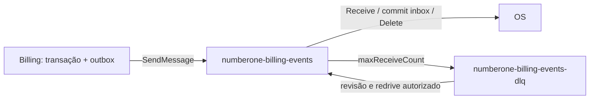

# Fila Billing → OS e DLQ

Uma fila principal, um produtor e um consumidor de negócio. Billing não consome
mensagens desta Saga; OS não publica eventos de Saga; Inventory só usa REST.
Outbox local da OS para histórico DynamoDB é outro mecanismo, não outra fila da Saga.

Nomes propostos: `numberone-billing-events` e `numberone-billing-events-dlq`.
**Standard/FIFO pendente Marcelo**. Se FIFO, ambos ganham `.fifo`, grupo proposto
`serviceOrderId`, deduplicação `eventId`; isso não elimina inbox nem guardas de versão.
Nenhum ARN, conta, região ou provisionamento foi presumido.

| Papel proposto | Recurso e permissões mínimas | Limite |
| --- | --- | --- |
| Billing runtime | `sqs:SendMessage` na principal; `GetQueueUrl` se resolução em runtime | Sem receber/excluir ou publicar na DLQ |
| OS runtime | `ReceiveMessage`, `DeleteMessage`, `ChangeMessageVisibility`, `GetQueueAttributes` e, se necessário, `GetQueueUrl` na principal | Sem SendMessage nem redrive administrativo |
| Operação/redrive | `StartMessageMoveTask`, `ListMessageMoveTasks`, `CancelMessageMoveTask`, leitura/remoção/atributos na DLQ e envio na principal, conforme mecanismo escolhido | Papel separado, auditado; confirmar permissões efetivas com Marcelo |
| Provisionamento | Políticas da fila, redrive e redrive-allow vinculando apenas a principal à DLQ | Não conceder ao workload |

Política de recurso restringe origem Billing e consumo OS; proibir principal público.
Identidade de workload, trust policy, TLS, criptografia e eventuais grants KMS
devem ser fechados por Marcelo. Não há JSON IAM aplicado ou identidade implantada.

## Política proposta para reprocessamento

- Ponto inicial para revisão: visibilidade 60 s com extensão antes de expirar;
  maxReceiveCount 5; retenção principal 4 dias, DLQ 14 dias. Marcelo deve ajustar
  ao tempo máximo de processamento e à política operacional. Valores não são
  configuração provisionada nem acordo firmado.
- Falha transitória ou falta de contexto: não DeleteMessage, retry com atraso
  limitado e jitter. Commit confirmado/duplicata idêntica: confirmar mensagem.
  Schema inválido, colisão de identidade ou erro persistente: diagnosticar e deixar
  política de recebimentos encaminhar à DLQ; não apagar silenciosamente.
- Alertas propostos: qualquer mensagem visível na DLQ, idade da mensagem principal
  acima do SLO acordado, backlog crescente e outbox Billing em revisão. SLO e
  destinatários de alerta ficam com Marcelo e os donos dos serviços.
- Redrive só após causa corrigida, validar amostra, limitar taxa e acompanhar erros.
  Preservar eventId e corpo original; evento incorreto que precise correção exige
  novo fato versionado pelo Billing, nunca editar mensagem e reutilizar ID.
- Registrar operador, motivo, lote/contagem, horário e resultado. Pausar redrive
  ao repetir falha. Permissões de redrive não pertencem à OS.
- Retenção inbox e tombstones de idempotência deve cobrir retenção, atrasos e
  redrives manuais. Proposta: não purgar antes de definir horizonte máximo;
  mensagens mais antigas exigem reconciliação antes de reenfileirar. Marcelo,
  Matheus, Julio e Anderson precisam acordar os prazos; DLQ 14 dias isoladamente
  não define todo o horizonte de replay.
